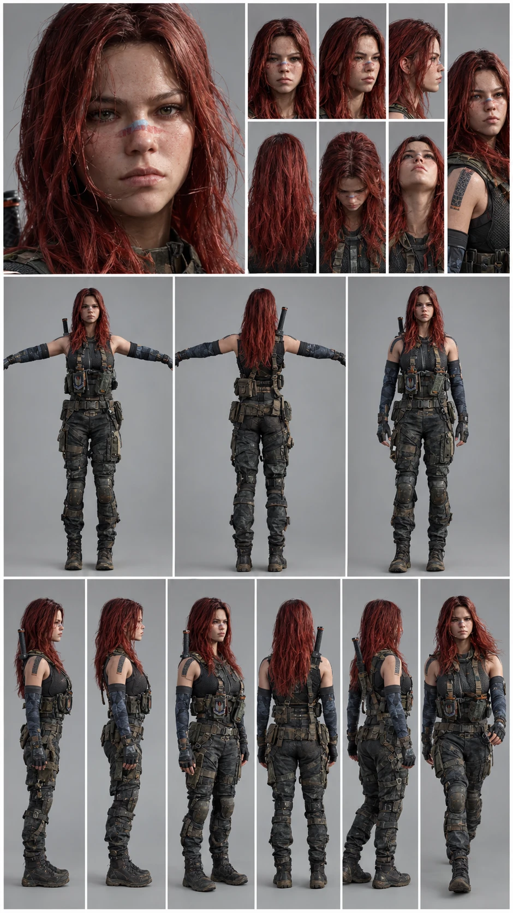
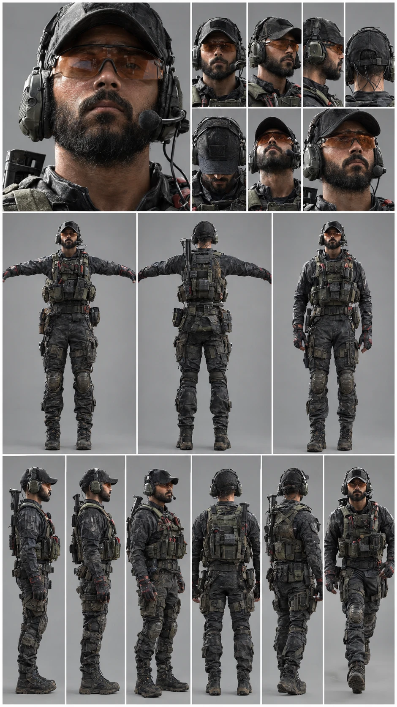
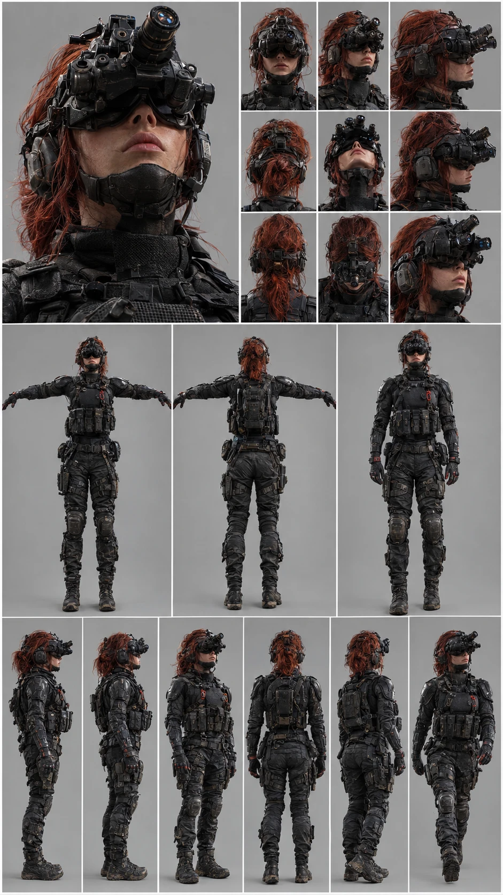

# Shadow Unit — Operators

Roadmap Step 2. Three operators, one per class. Each has one active ability and one passive perk, and none is best at everything.

The numbers live in Unity as `OperatorData` assets in `Assets/ShadowUnit/Resources/ShadowUnit/Operators/`. **Shadow Unit → Create Base Assets** creates them, and it never overwrites assets that already exist, so tune them in the Inspector. The abilities are designed here; the code for them comes in roadmap Step 7 (`AbilityController`).

## At a glance

| | **ZOX** | **Scott** | **Daed** |
|---|---|---|---|
| Class | Assault | Support | Recon |
| Health / armour | 100 / 25 | 100 / 75 | 90 / 50 |
| Move speed | 112% | 92% | 100% |
| Spotted by enemies at | 100% range | 110% range | 75% range |
| Health regen starts after | 3.5 s | 5 s | 5 s |
| Starting weapon | Hornet-9 SMG | VK-7 Carbine | Longreach DMR |
| Active ability | Red Rush (30 s cooldown) | Resupply Crate (45 s) | Night Sweep (35 s) |
| Passive perk | Second Wind | Comms Link | Quiet Feet |
| Best at | Close fights, retaking points | Keeping the squad alive | Finding enemies, long range |
| Weak at | Long range, soaking damage | Speed, staying hidden | Close range, low health |

## ZOX — Assault

**Backstory.** Grew up running salvage through flooded border towns. Joined Shadow Unit after her crew was wiped out by the people she now hunts. Fights up close, fast, and never in a straight line.

- **Active — Red Rush** (cooldown 30 s, lasts 5 s): +30% move speed, 40% faster reload and 20% less damage taken. She can fire while sprinting.
- **Passive — Second Wind:** health starts regenerating after 3.5 s without damage instead of 5 s.
- **Starting weapon:** Hornet-9 SMG.
- **Strength:** wins close fights and retakes capture points fastest.
- **Weakness:** light armour (25), so she loses long-range duels and can't soak damage.

## Scott — Support

**Backstory.** Former signals sergeant and the squad's voice in every earpiece. Keeps everyone stocked and alive. Talks calm, shoots steady.

- **Active — Resupply Crate** (cooldown 45 s, lasts 8 s): drops a crate; allies within 5 m get one magazine per second and heal 8 HP per second.
- **Passive — Comms Link:** enemies spotted by any teammate stay on the minimap 2 s longer, and allies within 15 m reload 10% faster.
- **Starting weapon:** VK-7 Carbine.
- **Strength:** keeps the squad fighting longer; heaviest armour (75).
- **Weakness:** slowest mover and easiest to spot; longest ability cooldown.

## Daed — Recon

**Backstory.** Nobody in the unit has seen his face in daylight. A night-raid specialist who reads the battlefield through four green tubes, he goes in first and quietly. When he speaks, it's a position.

- **Active — Night Sweep** (cooldown 35 s, lasts 4 s): pulses his quad-tube night vision; enemies within 40 m show on the minimap and through walls.
- **Passive — Quiet Feet:** footsteps are silent while crouched, and enemies spot him from 25% shorter range.
- **Starting weapon:** Longreach DMR.
- **Strength:** finds enemies first and wins long-range fights.
- **Weakness:** lowest health (90) and weak up close.

## Notes for later steps

- **Weapons (Step 7):** the Hornet-9 SMG and Longreach DMR are new `WeaponData` assets to create; the VK-7 Carbine already exists.
- **Armour (Step 5):** `Health` needs an armour value before the armour numbers do anything.
- **Art (Step 9):** the sheets above are the reference for the image-to-3D and Mixamo pipeline. ZOX's back-mounted blade and Daed's quad-tube night vision are their silhouette features; keep them readable at game distance.
