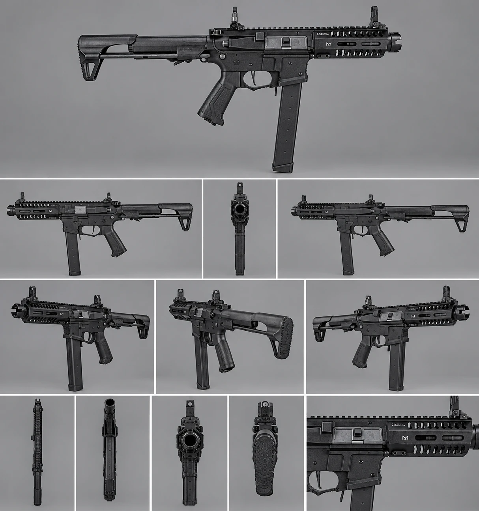
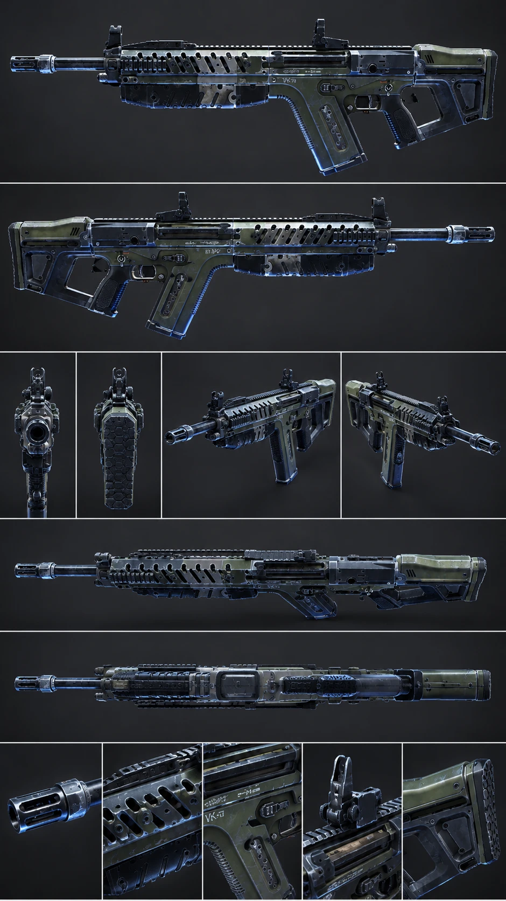
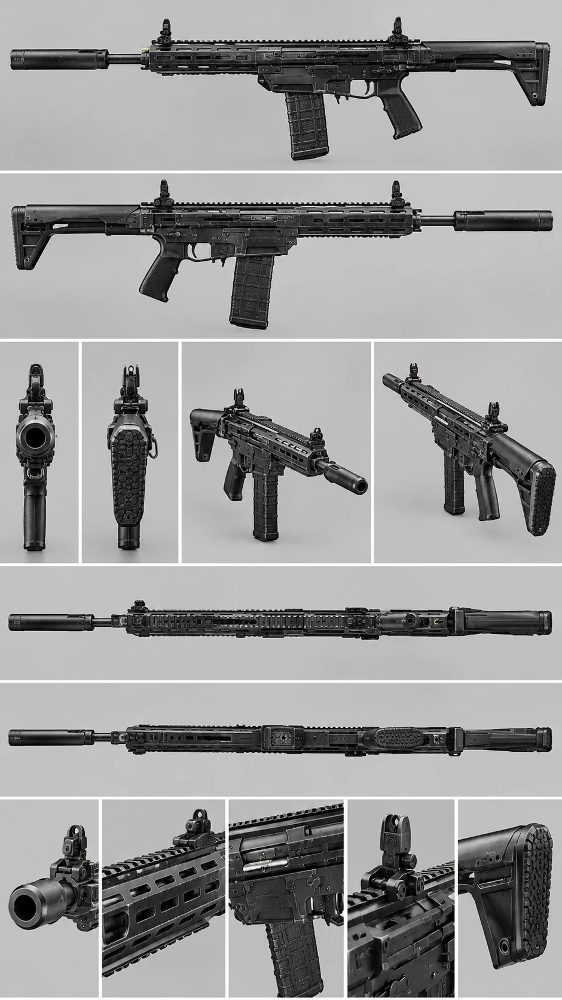

# Shadow Unit — Weapons

The three operator starting guns. Stats live in Unity as `WeaponData` assets in `Assets/ShadowUnit/Resources/ShadowUnit/Weapons/`; **Shadow Unit → Create Base Assets** creates any that are missing and never overwrites ones you have tuned.

**Try a gun now:** select the `ShadowUnit` object in the Frontline scene, drag a weapon asset into **Primary Weapon** on `GameBootstrap`, and press Play. Each gun has its own placeholder model until the real ones are imported.

## At a glance

| | **Hornet-9 SMG** | **VK-7 Carbine** | **Longreach DMR** |
|---|---|---|---|
| Used by | ZOX (Assault) | Scott (Support) | Daed (Recon) |
| Fire mode | Full auto, 900 rpm | Full auto, 700 rpm | Semi-auto, 300 rpm max |
| Damage (body / head) | 18 / 29 | 24 / 48 | 46 / 92 |
| Hits to kill (100 HP, body) | 6 | 5 | 3 |
| Full damage up to | 18 m | 45 m | 70 m |
| Magazine / reserve | 33 / 165 | 30 / 150 | 20 / 80 |
| Reload | 1.8 s | 2.1 s | 2.6 s |
| Aim-down-sights time | 0.13 s | 0.18 s | 0.26 s |
| Zoom (ADS field of view) | 58° | 50° | 38° |
| Hip-fire spread | Tight (1.8°) | Medium (2.4°) | Wide (3.5°) |
| Recoil | Light, jittery | Medium | Heavy single kick |
| Suppressed | No | No | **Yes**: quieter, smaller flash, enemies hear it only within 18 m (45 m for the others) |
| Shop price | 1,200 | 1,500 | 2,400 |
| Best at | Room clearing, hip-fire on the move | All-rounder | Picking enemies off at range unheard |
| Weak at | Damage drops off fast past 18 m | Nothing outstanding | Slow to aim, poor up close |

## Hornet-9 SMG

Compact 9 mm submachine gun with a long stick magazine and a skeleton stock. Fastest firing and quickest to aim; loses most of its damage past 18 m.

## VK-7 Carbine

Olive-and-steel carbine with an angular stock: the balanced rifle that bots and new players carry.

## Longreach DMR

Long suppressed marksman rifle with a 20-round magazine. Three body hits or a head and a body hit to kill. Its suppressor suits Daed's quiet-recon kit.

## Notes for the art phase (roadmap Step 9)

- Use these sheets as **reference only** when modelling. Keep Shadow Unit's guns its own: leave out manufacturer logos and markings (the Hornet-9 photo carries a maker's logo on the receiver), and change a few silhouette details on the Hornet-9 and Longreach so they don't copy a real product. The VK-7 already has its own look and "VK-7" marking.
- Keep the sight line clear when modelling optics: the camera looks straight down the sight when aiming, so the lens must be see-through with a reticle, not a solid block.
