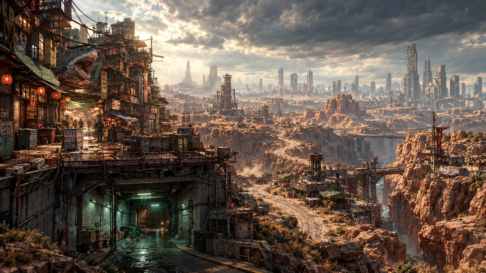
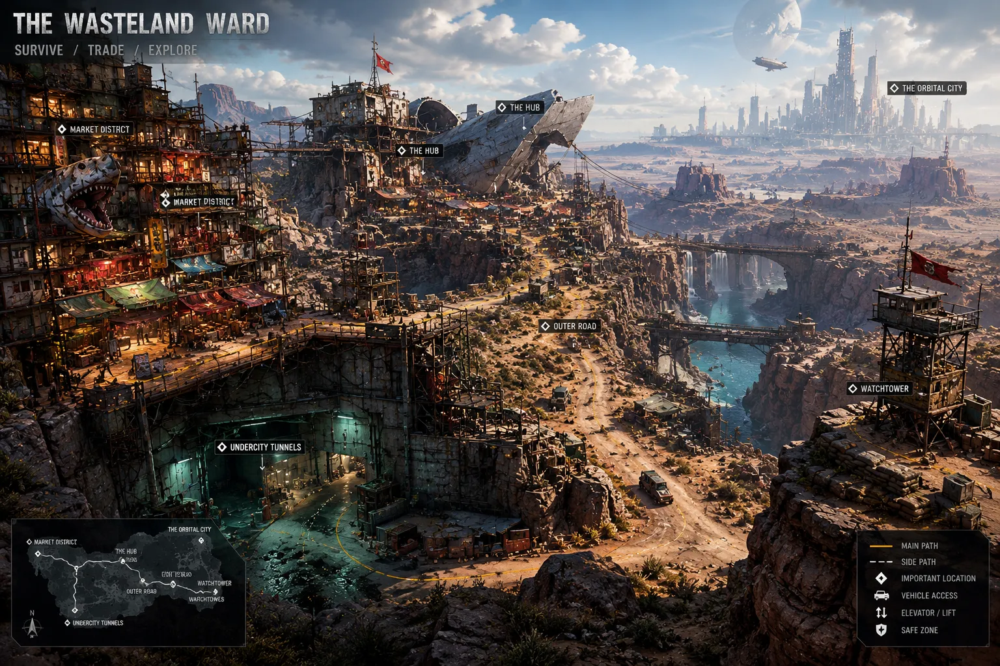
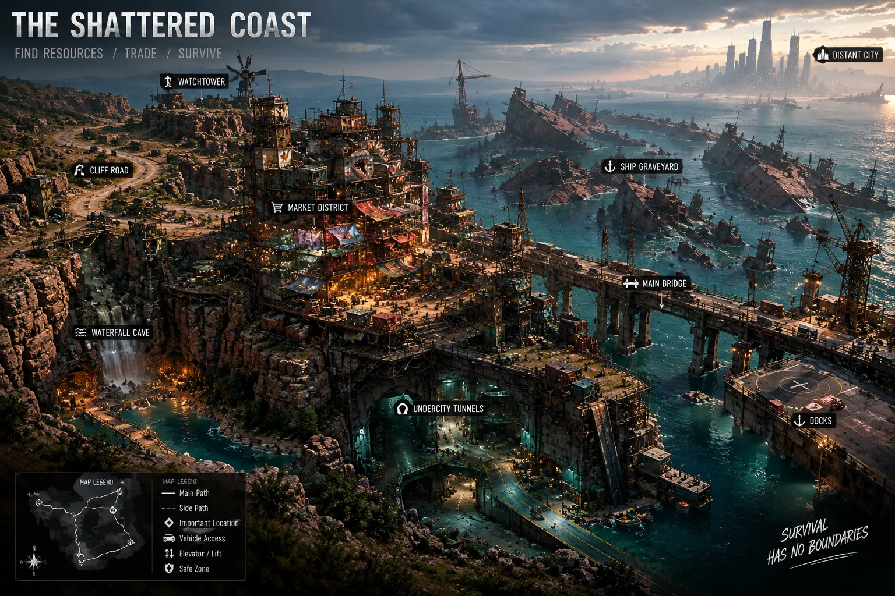
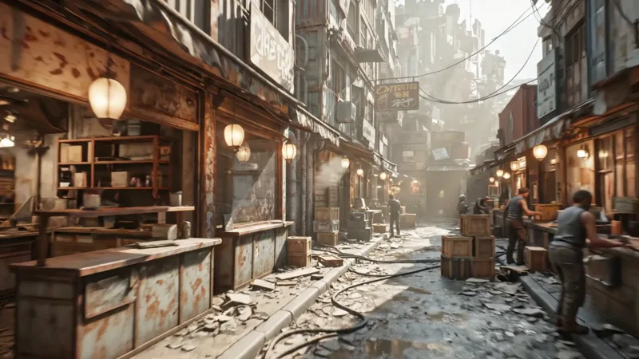
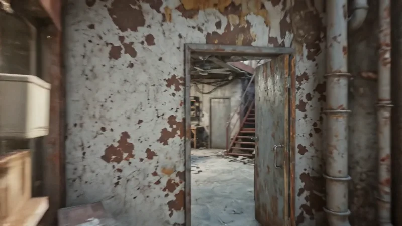
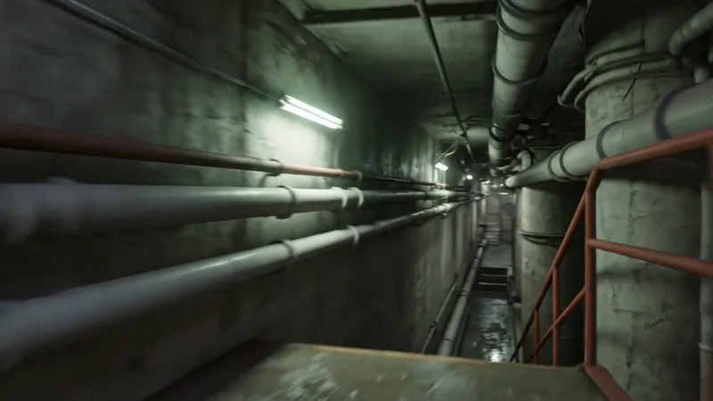
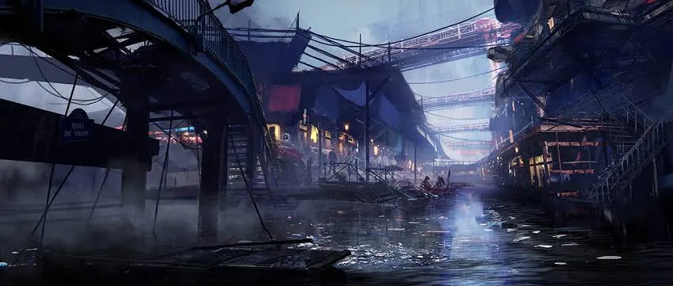

# Shadow Unit — World and Levels

Roadmap Steps 1 and 3, built from the environment art and maps. This is a first draft of the story; rename anything you like.



## The pitch

**Hook.** The river that keeps the canyon alive is being stolen, one pipe at a time. Shadow Unit goes into the Ward to find out who is drinking it.

**Setting.** The Kharos Canyon, in the fictional country of Valdera, 2068. Decades after the Dry Years broke the region, the people who could afford it moved into the sealed towers of the **Orbital City** on the horizon. Everyone else lives below, in scrap settlements stacked on the canyon cliffs: **the Wasteland Ward**. Downriver, where the canyon meets the sea, lies **the Shattered Coast**: a graveyard of beached ships and docks.

**Enemies.**
- **The Maw Syndicate.** The gang that runs the Ward's market and sells its water. Their emblem is the giant shark head hung over the Market District. Levels 1–3.
- **The Spire Directorate.** The Orbital City's private security force, secretly paying the Syndicate to pump the canyon river up to the towers. Levels 4–5.

**Shadow Unit.** Three off-the-books operators hired by the Ward's settler council: [ZOX, Scott and Daed](OPERATORS.md).

**Core loop.** Pick an operator → deploy into the Ward → complete objectives → extract → unlock gear.

**Modes (all offline).**
- **Campaign** *(launch mode)*: the five levels below.
- **Battle Mode**: you and an AI squad against AI over capture points. The current prototype map (Kessel Crossing) will be rebuilt as the Wasteland Ward, with points at the Market District, the Hub and the Watchtower.
- **Extraction Run** *(post-launch)*: scavenge the Shattered Coast for loot and get out; loot carried is lost on death.

**Feel.** Sun-bleached, tense, vertical, scrappy, defiant.

## The places

Two map areas, matching the concept maps. Each place is a campaign level setting and can also be a Battle Mode or Extraction Run zone.

### The Wasteland Ward (canyon)



| Place | What it is | Gameplay |
|---|---|---|
| **Market District** | Stacked stalls and lantern-lit streets under the Syndicate's shark-head sign | Close-quarters streets, balconies, shop interiors; level 1 |
| **The Hub** | A settlement built inside a crashed sky-freighter on the cliff edge | Fortress assault, tilted hull interiors; level 3 boss |
| **Undercity Tunnels** | Old waterworks under the Ward: pipes, cisterns, maintenance lifts | Dark, narrow, flooded rooms; level 2 |
| **Outer Road** | Dirt road along the canyon floor, with vehicle access | Extraction by truck, long sightlines |
| **Watchtower** | Sandbagged tower on the far cliff with a radio relay | High ground, sniping; level 5 boss |
| **The Orbital City** | Sealed towers on the horizon | Backdrop only (never playable at launch) |

### The Shattered Coast (sea)



| Place | What it is | Gameplay |
|---|---|---|
| **Ship Graveyard** | Rusting hulks beached in the shallows | Cover-to-cover over wrecks; level 4 |
| **Main Bridge** | Long road bridge over the bay | Exposed crossing, destructible span |
| **Docks** | Piers, cranes and a helipad | Defend objective; Extraction Run exit |
| **Market District (coast)** | Second market tower on the cliffs | Extraction Run trading hub |
| **Waterfall Cave** | Cave behind a waterfall at the cliff foot | Hidden route; level 5 extraction |
| **Cliff Road** | Switchback road up from the coast | Escort route; level 5 |

**Map legend meanings.** *Main path*: the critical route through a level. *Side path*: flanking routes for players and bots. *Vehicle access*: extraction vehicles. *Elevator / lift*: vertical shortcuts between cliff levels. *Safe zone*: spawn areas where nobody can shoot (Battle Mode and Extraction Run).

## Look and mood

The first-person walkthrough sets the look: sunlit dust in narrow market streets, peeling plaster interiors, and cold fluorescent tunnels below.

| Market street | Interiors | Undercity tunnels |
|---|---|---|
|  |  |  |



- **Palette:** warm dusty orange and red rock above ground; teal and cold green underground; red lanterns and signs as accents.
- **Light:** low sun with long shadows and haze (fog) in the canyon; flickering fluorescent tubes in the Undercity.
- **Details that repeat:** the shark-head sign (the Syndicate's mark), hanging cables, scaffolding, stacked containers, hand-painted signs.
- **Sound:** wind in the canyon, market chatter, dripping water and pipe hum underground.

**Licence note.** Use these images as reference only. The back-alley screenshot carries a studio's watermark, and the Blender alley shot is someone else's asset; buy or licence an asset (or build your own) before anything like it goes into the game. Keep sign text made-up rather than copying real shop signs.

## Campaign levels

Five levels, each set in a place from the maps above. Difficulty rises level by level, with a boss on levels 3 and 5. The same values are in the `LevelData` assets in `Assets/ShadowUnit/Resources/ShadowUnit/Levels/` (**Shadow Unit → Create Base Assets**; existing assets are never overwritten).

| # | Level | Location | Objectives | Enemies | Boss | Time |
|---|---|---|---|---|---|---|
| 1 | **Lantern Row** | Market District | 2 | 12 | — | ~6 min |
| 2 | **Below the Ward** | Undercity Tunnels | 2 | 14 | — | ~7 min |
| 3 | **The Wreck** | The Hub | 3 | 16 | Mother Maw | ~8 min |
| 4 | **Ship Graveyard** | The Shattered Coast | 3 | 18 | — | ~8 min |
| 5 | **The Last Watch** | Cliff Road and the Watchtower | 3 | 20 | Warden Voss | ~10 min |

**Grid key:** `S` spawn, `O` objective, `#` walls and cover, `E` enemy group, `B` boss, `X` extraction, `~` water, `=` bridge, `.` open ground. North is up; each cell is roughly 4 m.

### Level 1: Lantern Row

**Location:** Market District · **Difficulty:** 1/5 · **Play time:** about 6 minutes

**Story:** The Ward's water stalls doubled their prices overnight. An informant in the Market District says the Maw Syndicate keeps a ledger of who is buying the stolen river water, and who is selling it.

**Objectives**

1. *Reach:* Meet the informant at the noodle stall halfway up Lantern Row.
2. *Steal intel:* Steal the Syndicate ledger from the counting house under the shark sign.

**Extraction:** Outer Road gate (east side)

**Enemies:** 12: Syndicate enforcers (rifles), lookouts on balconies (SMGs).

**Wow moment:** A firefight cuts the ropes on the giant shark-head sign and it crashes into the street, opening a new path and crushing a Syndicate barricade.

```text
####################
#..E....#O#....E...#
#.##.##.#.#.##.##..#
#.......#.#........#
#.#..E..###...E.#..#
#.#.............#..#
#...##.##..##.##...X
#..................#
#.##..E.##..##.E.#.#
#.#.......O......#.#
#.##.##.....##.##..#
#.....E.......E....#
#.##.##.##..##.##.##
#...........E......#
#.#.#.#.#..#.#.#.#.#
#..................#
#.##.##..##..##.##.#
#.........S........#
#.........S........#
####################
```

### Level 2: Below the Ward

**Location:** Undercity Tunnels · **Difficulty:** 2/5 · **Play time:** about 7 minutes

**Story:** The ledger points underground: the Syndicate has tapped the old waterworks beneath the Ward and is pumping the river out through the Undercity Tunnels. A settler engineer who found the pumps has gone missing down there.

**Objectives**

1. *Destroy:* Wreck the three pump valves feeding the Syndicate's pipeline.
2. *Rescue:* Find and free the captured settler engineer.

**Extraction:** Maintenance lift to the surface (south-east)

**Enemies:** 14: Syndicate enforcers, shotgunners in tight corridors, a sniper over the flooded cistern.

**Wow moment:** Blowing the last valve bursts the main pipe: the cistern floods, the lights fail and the squad fights out by torchlight.

```text
####################
#S.....#....E....O.#
#S.###.#.#####.###.#
#..#...#.....#...#.#
#..#.E.###.#.#.E.#.#
#..#.......#.#...#.#
#.####.###.#.###.#.#
#......#~~~~~~~#...#
#.E.##.#~~~~~~~#.E.#
#...#..#~~O~~~~#...#
#.###..#~~~~~~~#.###
#......####.####...#
#.####......E....#.#
#....#.####.####.#.#
#.E..#.#O......#.#.#
#.##.#.#.####..#...#
#.#..E.#....#.E###.#
#.#.####.##.#.....O#
#..........E#.....X#
####################
```

### Level 3: The Wreck

**Location:** The Hub · **Difficulty:** 3/5 · **Play time:** about 8 minutes

**Story:** With the pumps down, the Syndicate pulls back to its fortress: the Hub, a settlement built inside a crashed sky-freighter. The engineer's notes show the pipeline carries on past the Hub, towards the Orbital City.

**Objectives**

1. *Destroy:* Cut the Hub's power at the generator yard.
2. *Reach:* Breach the freighter hull and reach the bridge deck.
3. *Destroy:* Defeat Mother Maw.

**Extraction:** Armoured truck on the Outer Road

**Enemies:** 16: Syndicate enforcers, shotgunners, heavy gunners on the hull, Mother Maw's guards.

**Boss: Mother Maw.** Syndicate leader in scrap plate armour with a belt-fed gun. Armour phases at 66% and 33% health; at each phase she calls 2 guards and drops a smoke screen. Weak spot: the fuel canister on her back.

**Wow moment:** Cutting the power drops the freighter's tail section: the hull slides a few metres down the cliff mid-fight and the floor tilts.

```text
####################
#.....##########...#
#....#....B.....#..#
#...#..E.....E...#.#
#..#.###.##.###...##
#..#....O.....E...##
#...#.##.###.##..#.#
#....#..E......##..#
#.....##########...#
#..........#.......#
#..##..E...#...##..#
#..##......#.E.##..#
#......##.....##...#
#.E....##..O..##.E.#
#..##.........##...#
#..##..##..##......#
#......##..##..E...#
#.S..............X.#
#.S................#
####################
```

### Level 4: Ship Graveyard

**Location:** The Shattered Coast · **Difficulty:** 4/5 · **Play time:** about 8 minutes

**Story:** The pipeline ends at the Shattered Coast, where Spire Directorate troops load water tankers bound for the Orbital City. The settlers want their people off the coast before the Directorate seals it.

**Objectives**

1. *Reach:* Secure the foot of the Main Bridge.
2. *Defend:* Hold the docks for 90 seconds while the settlers' boats leave.
3. *Destroy:* Bring down the Directorate radio mast on the beached tanker.

**Extraction:** Cliff Road switchback (east)

**Enemies:** 18: Directorate riflemen with armour, marksmen on wrecks, a landing squad mid-level.

**Wow moment:** Directorate charges blow a span out of the Main Bridge while the squad is crossing; they finish the crossing over the wrecks instead.

```text
####################
#~~~~##~~~~~~##~~~~#
#~~~####~~~~####~~~#
#~~~~##~~~O~~##~~~~#
#~~~~~~~~~~~~~~~~~~#
#~~##~~~~~~~~~~##~~#
#=================.#
#~~~~E~~~~~E~~~~~~.#
#~~~~~~~~~~~~~~~~~.#
#....##....##......#
#.E..##.O..##..E...#
#......E.......##..#
#.##..####..##.##..#
#.##..#..#..##.....#
#.....#O.#...E..##.#
#..E..####.......X.#
#.##.......##..##..#
#.S...##...##......#
#.S................#
####################
```

### Level 5: The Last Watch

**Location:** Cliff Road and the Watchtower · **Difficulty:** 5/5 · **Play time:** about 10 minutes

**Story:** The Directorate's commander is up at the old Watchtower, the only relay that can reach every settlement in the canyon. Send the ledger and the pipeline records from there and the whole Ward learns who has been stealing its river.

**Objectives**

1. *Escort:* Get the settler engineer up the Cliff Road to the Watchtower.
2. *Steal intel:* Transmit the ledger from the Watchtower relay.
3. *Destroy:* Defeat Warden Voss.

**Extraction:** The pool below the Waterfall Cave

**Enemies:** 20: Directorate riflemen, marksmen, armoured heavies, a recon drone.

**Boss: Warden Voss.** Spire Directorate commander in powered armour with a shield drone. Armour phases at 66% and 33%: first the drone shields him, then he calls a landing squad, then he charges. Shoot the drone down to open the shield.

**Wow moment:** As the transmission finishes, the Watchtower's legs give way; the squad jumps from the collapsing tower into the river and swims for the Waterfall Cave.

```text
####################
#....#####B#####...#
#....#...O.....#...#
#....#..E...E..#...#
#....###.....###...#
#......#.....#.....#
#.##...........E.###
#....E....##.......#
###..........##....#
#....##..E.......E.#
#.........###......#
#.E..###.......##..#
#......#...E.......#
#.##...........##..#
#....##..##........#
#~~~.............E.#
#~X~...##....##....#
#~~~..........S....#
#~~~..........S....#
####################
```
